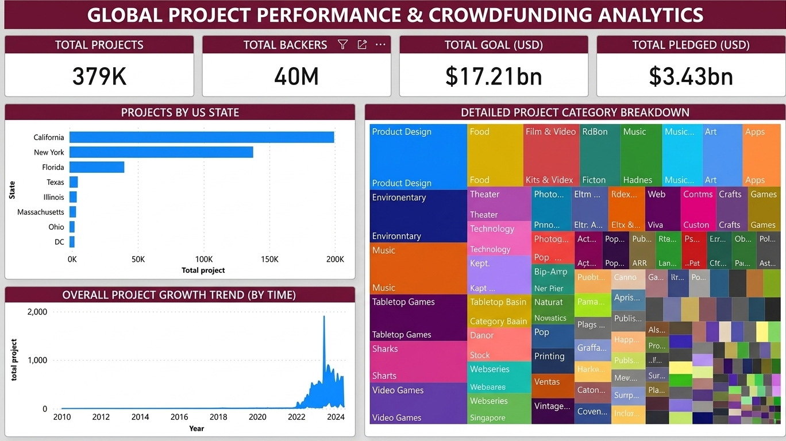

# 🌍 Global Project Performance & Crowdfunding Analytics
### 379K Projects | 40M Backers | $17.21bn Goal | $3.43bn Pledged

## 📊 Executive KPIs
| KPI | Value |
| :--- | :--- |
| **Total Projects** | **379K** |
| **Total Backers** | **40M** |
| **Total Goal (USD)** | **$17.21bn** |
| **Total Pledged (USD)** | **$3.43bn** |
| **Funding Rate** | **19.9%** |

## 📈 Key Insights
- **California ~200K + New York ~150K = 92%** of US projects – hyper-concentrated
- **2023 Peak:** ~2,000 projects – breakout year
- **Top Category:** Product Design dominates
- **Funding Gap:** $13.78bn unachieved

## 🖥️ Dashboard Preview

## 🛠️ Tools: Power BI, DAX, Treemap, Geospatial Analysis

## 👩‍💻 Author: Nermeen Elsayed Farg
[LinkedIn](https://linkedin.com/in/nermeen-farg) | [GitHub](https://github.com/nermeenfarg)

---
🌍 379K Projects Analyzed
